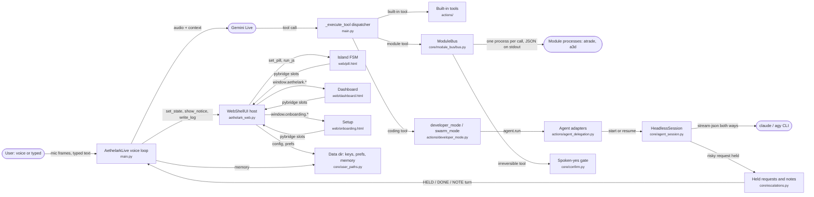

# Architecture

Generated by `tools/architecture.py` from the source. Do not edit by hand: run `python tools/architecture.py`. `tests/test_architecture_map_is_current.py` fails when this file and the code disagree.

## Data flow

Every arrow is checked: the file it starts from must still contain the evidence string listed under it in `tools/architecture.py`.

## Voice tools (35)

Declared in `main.py` `TOOL_DECLARATIONS`, run by `AethelarkLive._execute_tool`. `coding` tools need CODING mode, `labs` tools the Labs switch (`main.tool_enabled`). Module tools are added at runtime from each installed module's manifest and run through `ModuleBus.invoke`.

| tool | gate | handled in | first sentence of its description |
|---|---|---|---|
| `island_view` | always | main.py | Change how much the island shows for the card on screen or for something that is running. |
| `island_deck_move` | always | main.py | Move to another model in the row of models currently on screen. |
| `print_picked` | always | main.py | Print the models the user has picked on screen, each on the printer shown on its card. |
| `island_picks` | labs | main.py | Read which models the user has picked on screen and which printer each one is going to. |
| `island_set_printer` | always | main.py | Choose which printer the model currently on screen should go to, and mark it as picked. |
| `open_app` | always | actions.open_app | Opens an application installed on the computer. |
| `web_search` | always | actions.web_search | Looks something up on the web. |
| `system_status` | always | main.py | Returns real-time system metrics: CPU usage, RAM, GPU load, CPU temperature, uptime, and process count. |
| `weather_report` | always | actions.weather_report | Current weather and today's high and low for a city, as a short sentence to say out loud. |
| `send_message` | labs | actions.send_message | Sends a WhatsApp or Telegram message from the user's account. |
| `reminder` | always | actions.reminder | Sets, lists or cancels reminders. |
| `youtube_video` | always | actions.youtube_video | Plays a YouTube video by name, summarizes a video's content, gets video info, or shows trending videos. |
| `screen_process` | always | main.py | Captures the screen or webcam image and lets you analyze it. |
| `computer_settings` | always | actions.computer_settings | Controls the computer: volume, brightness, window management, keyboard shortcuts, typing text on screen, closi |
| `browser_control` | always | actions.browser_control | Opens a website in the USER'S OWN browser, with their own logins and tabs — for when they want to look at some |
| `youtube_api` | labs | actions.youtube_api | The user's OWN YouTube account, read directly through the Google account they already connected to Aethelark — |
| `web_agency` | always | actions.web_agency | Uses a website the way a person would, in the eagle's OWN browser: reads the page's real controls, then clicks |
| `file_controller` | always | actions.file_controller | Manages files and folders: list, create, delete, move, copy, rename, read, write, find, disk usage -- and undo |
| `mission` | labs | actions.mission | Run a goal that takes MORE THAN ONE action across DIFFERENT applications, as a sequence of small verified step |
| `desktop_control` | labs | actions.desktop | Controls the desktop: wallpaper, organize, clean, list, stats. |
| `code_helper` | coding | actions.code_helper | Writes, edits, explains, runs, or builds code files. |
| `dev_agent` | coding | actions.dev_agent | Builds complete multi-file projects from scratch: plans, writes files, installs deps, opens VSCode, runs and f |
| `developer_mode` | coding | actions.developer_mode | Hands one task to ONE coding agent on this computer and types it into that agent's chat. |
| `swarm_mode` | coding | actions.swarm_orchestrator | THE FRONT DOOR for building software. |
| `eagle_mode` | always | main.AethelarkLive._switch_mode | Switches the eagle between CASUAL and CODING. |
| `swarm_status` | coding | actions.swarm_orchestrator | What the swarm is doing RIGHT NOW, in plain speakable language. |
| `agent_interject` | coding | actions.agent_delegation | Stop a running coding agent mid-work and optionally redirect it with a new instruction. |
| `computer_control` | labs | actions.computer_control | Direct computer control: type, click, hotkeys, scroll, move mouse, screenshots, find elements on screen. |
| `flight_finder` | labs | actions.flight_finder | Finds flights on Google Flights and says the cheapest three. |
| `autostart` | always | actions.autostart | Enable, disable, or check auto-start on boot — whether Aethelark launches automatically when the user logs int |
| `messages_brief` | labs | actions.messages_brief | Brief the user on their UNREAD messages across channels (Gmail + WhatsApp). |
| `mark_emails_read` | labs | actions.messages_brief | Mark Gmail messages as read (clears the unread flag). |
| `shutdown_aethelark` | always | main.py | Quits the Aethelark app completely. |
| `file_processor` | labs | actions.file_processor | Processes a file the user sent from their phone (the remote dashboard's upload), or any file given by its full |
| `save_memory` | always | main.py | Save an important personal fact about the user to long-term memory. |

## Island states

From `GEOM` in `web/pill.html`. Rules for the state machine are in `CLAUDE.md`.

| state | size | `set_pill` from Python | `_go` inside the page |
|---|---|---|---|
| `idle` | 168×46 | 0 | 8 |
| `activity` | 320×62 | 0 | 0 |
| `listening` | 320×62 | 0 | 1 |
| `thinking` | 320×62 | 0 | 1 |
| `speaking` | 320×62 | 0 | 0 |
| `swarm` | 320×62 | 0 | 0 |
| `ready` | 320×62 | 3 | 0 |
| `capsule` | 320×62 | 0 | 0 |
| `notice` | 320×52 | 2 | 0 |
| `glance` | 440×236 | 0 | 2 |
| `expanded` | 440×364 | 0 | 2 |

The voice-loop states reach the island through `WebShellUI._pill_state`; module cards through `set_pill_context`.

## Python → page calls

| page | entry | Python calls | defined in the page |
|---|---|---|---|
| web/dashboard.html | `window.aethelark` | `playMorph` | yes |
| web/dashboard.html | `window.aethelark` | `setLog` | yes |
| web/dashboard.html | `window.aethelark` | `setMemory` | yes |
| web/dashboard.html | `window.aethelark` | `setMetrics` | yes |
| web/dashboard.html | `window.aethelark` | `setMode` | yes |
| web/dashboard.html | `window.aethelark` | `setModuleShop` | yes |
| web/dashboard.html | `window.aethelark` | `setSettings` | yes |
| web/dashboard.html | `window.aethelark` | `setState` | yes |
| web/dashboard.html | `window.aethelark` | `setSuggestions` | yes |
| web/dashboard.html | `window.aethelark` | `setSwarm` | yes |
| web/onboarding.html | `window.onboarding` | `clipboardKey` | yes |
| web/onboarding.html | `window.onboarding` | `foundKey` | yes |
| web/onboarding.html | `window.onboarding` | `keyPageOpened` | yes |
| web/onboarding.html | `window.onboarding` | `setAec` | yes |
| web/onboarding.html | `window.onboarding` | `setChrome` | yes |
| web/onboarding.html | `window.onboarding` | `setKeyResult` | yes |
| web/onboarding.html | `window.onboarding` | `setMic` | yes |
| web/onboarding.html | `window.onboarding` | `setModuleProgress` | yes |
| web/onboarding.html | `window.onboarding` | `startAt` | yes |
| web/pill.html | `window.island / window.pill` | `actionDone` | yes |
| web/pill.html | `window.island / window.pill` | `goTo` | yes |
| web/pill.html | `window.island / window.pill` | `level` | yes |
| web/pill.html | `window.island / window.pill` | `refineCandidate` | yes |
| web/pill.html | `window.island / window.pill` | `registerModule` | yes |
| web/pill.html | `window.island / window.pill` | `send` | yes |
| web/pill.html | `window.island / window.pill` | `set` | yes |
| web/pill.html | `window.island / window.pill` | `setActivities` | yes |
| web/pill.html | `window.island / window.pill` | `setLive` | yes |
| web/pill.html | `window.island / window.pill` | `setPrinter` | yes |

## Page → Python slots

### web/dashboard.html

Hosted by `DashWindow`, bridge `WebBridge` (`aethelark_web.py`). Page → Python slots:

| slot | called by the page |
|---|---|
| `ready` | yes |
| `collapse` | yes |
| `minimize` | yes |
| `quit` | yes |
| `send_command` | yes |
| `interrupt` | yes |
| `halt_swarm` | yes |
| `set_mode` | yes |
| `module_get` | yes |
| `module_remove` | yes |
| `toggle_mute` | yes |
| `aesthetic_options` | yes |
| `set_aesthetic` | yes |
| `open_settings` | yes |
| `save_settings` | yes |
| `set_autostart` | yes |
| `set_brain_key` | yes |
| `connect_google` | yes |
| `disconnect_google` | yes |
| `link_whatsapp` | yes |
| `browser_sign_in` | yes |
| `connect_youtube` | yes |
| `chrome_setup` | yes |
| `chrome_off` | yes |
| `rerun_onboarding` | yes |
| `begin_drag` | yes |
| `drag_to` | yes |

### web/onboarding.html

Hosted by `OnboardingWindow`, bridge `OnboardBridge` (`aethelark_web.py`). Page → Python slots:

| slot | called by the page |
|---|---|
| `onboard_ready` | yes |
| `validate_key` | yes |
| `get_key` | yes |
| `use_found_key` | yes |
| `open_url` | yes |
| `start_modules` | yes |
| `start_mic_check` | yes |
| `stop_mic_check` | yes |
| `enable_echo_cancel` | yes |
| `chrome_setup` | yes |
| `complete` | yes |
| `quit` | yes |
| `begin_drag` | yes |
| `drag_to` | yes |

### web/pill.html

Hosted by `PillWebWindow`, bridge `PillBridge` (`aethelark_web.py`). Page → Python slots:

| slot | called by the page |
|---|---|
| `expand` | yes |
| `interrupt` | yes |
| `open_key_settings` | yes |
| `request_depth` | yes |
| `prefetch_depth` | yes |
| `hit_region` | yes |
| `deck_size` | yes |
| `deck_state` | yes |
| `island_subject` | yes |
| `fleet_state` | yes |
| `selection_state` | yes |
| `island_trace` | yes |
| `open_activity` | yes |
| `refine_pick` | yes |
| `module_action` | yes |
| `island_collapsed` | yes |
| `island_opened` | yes |
| `island_deadline` | yes |
| `live_media` | yes |
| `begin_drag` | yes |
| `drag_to` | yes |

## Where data lives

| function | says |
|---|---|
| `user_paths.user_data_dir()` | The platform's per-user data directory for this application. |
| `user_paths.ensure_private_dir()` | Create `path` (and parents) and make it owner-only where the OS allows. |
| `user_paths.config_dir()` | Owner-only directory holding this user's credentials. |
| `user_paths.write_private()` | Write a credential and leave it readable only by its owner. |
| `user_paths.api_keys_path()` | The one answer to "where are the API keys?". |
| `user_paths.google_token_path()` |  |
| `user_paths.browser_profile_dir()` | The eagle's own browser profile. |

## Files

### Top level

| file | says it is |
|---|---|
| `aethelark_web.py` | Aethelark: the app's entry point. |
| `main.py` |  |
| `setup.py` | Space-Eagle / Aethelark 3D Environment Bootstrap & Dependency Installer. |
| `setup_google.py` | One-shot Google connect: save your OAuth client ID, then run the login flow. |
| `ui.py` | What the web shell needs from the old cockpit, and nothing else. |

### actions/

| file | says it is |
|---|---|
| `actions/agent_delegation.py` | Agent delegation with persistent single-session memory. |
| `actions/agent_screen.py` | Virtual VT100 screen watcher for agent PTY sessions. |
| `actions/app_settings.py` | Central read/write for everything the Settings panel exposes. |
| `actions/autostart.py` | Cross-platform auto-start on boot — parity+ with Mark-XLIX. |
| `actions/browser_control.py` |  |
| `actions/chief_architect.py` | Chief Architect — the planning trace of the swarm. |
| `actions/cli/audio/linux.py` | Volume on Linux: PipeWire first, then PulseAudio, then ALSA. |
| `actions/cli/audio/macos.py` | Volume on macOS, via osascript. |
| `actions/cli/audio/windows.py` | Volume on Windows, via pycaw's scalar API. |
| `actions/cli/base.py` | What every clified backend is, and the seam that makes it testable. |
| `actions/cli/media/linux.py` | Media transport on Linux, over MPRIS — the interface every player already |
| `actions/cli/media/macos.py` | Media transport on macOS, via osascript — honest partial coverage. |
| `actions/cli/media/windows.py` | Media transport on Windows, via SMTC. |
| `actions/cli/registry.py` | Resolve the platform once. |
| `actions/cli/window/linux.py` | X11 window control through xdotool. |
| `actions/code_helper.py` |  |
| `actions/computer_control.py` |  |
| `actions/computer_settings.py` |  |
| `actions/desktop.py` |  |
| `actions/dev_agent.py` |  |
| `actions/developer_mode.py` |  |
| `actions/file_controller.py` | File operations exposed to the model as one tool. |
| `actions/file_processor.py` | file_processor.py — Aethelark Universal File Processor |
| `actions/flight_finder.py` |  |
| `actions/flights/dates.py` |  |
| `actions/flights/google.py` |  |
| `actions/flights/model.py` |  |
| `actions/flights/places.py` |  |
| `actions/google_auth.py` | Google sign-in for onboarding — Desktop OAuth (loopback + PKCE). |
| `actions/grounding/actionability.py` | Is this element actually ready to be acted on? |
| `actions/grounding/atspi.py` | Read the accessibility tree instead of guessing at pixels. |
| `actions/grounding/base.py` |  |
| `actions/grounding/bootstrap.py` | Make the OS accessibility layer reachable from inside the virtualenv. |
| `actions/grounding/cache.py` |  |
| `actions/grounding/focus.py` | Whether keyboard focus is known — moved out of core/mission_runners.py |
| `actions/grounding/macos.py` | Structural grounding on macOS, via the Accessibility API. |
| `actions/grounding/resolver.py` |  |
| `actions/grounding/roles.py` | One vocabulary for what a control *is*, across three operating systems. |
| `actions/grounding/verify.py` | Look, act, look again. |
| `actions/grounding/vision.py` | Vision grounding — the fallback for surfaces that publish no structure. |
| `actions/grounding/waiting.py` | Wait for an element to be genuinely ready, the way a person does. |
| `actions/grounding/web/attach.py` | Reach into the Chrome the eagle already opened for the user. |
| `actions/grounding/web/browser.py` | One browser the eagle owns, kept warm, on its own thread. |
| `actions/grounding/web/chrome_link.py` | Work in the user's own Chrome, where they are already signed in. |
| `actions/grounding/web/consent.py` | The line the eagle does not cross by itself: controls that commit something are |
| `actions/grounding/web/grounder.py` | Locate a control on a web page by the words a person would use for it. Matching is |
| `actions/grounding/web/handoff.py` | Hand the keyboard back when the site is asking for a person: stop, say what is |
| `actions/grounding/web/outcome.py` | Did the click actually DO something? |
| `actions/grounding/web/page.py` | The seam between a live page and the grounding types. No Playwright import, so |
| `actions/grounding/web/sense.py` | How much of a page to look at. |
| `actions/grounding/web/sessions.py` | Which sites the eagle's browser is signed into. |
| `actions/grounding/web/user_actions.py` | Act on the browser the eagle opened FOR THE USER — one implementation, |
| `actions/grounding/web/vision_click.py` | VisionGrounder, pointed at a page instead of the desktop. |
| `actions/grounding/windows.py` | Structural grounding on Windows, via UI Automation. |
| `actions/machine_profile.py` | Machine detection + local-brain recommendation for onboarding. |
| `actions/messages_brief.py` | Unread-messages brief across the user's channels (Gmail, WhatsApp, …). |
| `actions/messaging/telegram.py` |  |
| `actions/messaging/whatsapp.py` |  |
| `actions/mission.py` | Run a goal as a sequence of small, verified steps. |
| `actions/open_app.py` |  |
| `actions/proactive.py` | Deciding there is something worth saying, and saying how long it has been. |
| `actions/pty_session.py` | Persistent PTY session pool for delegated agent CLIs. |
| `actions/reminder.py` | Reminders: said once, shown on this computer when they are due. |
| `actions/repo_map.py` | Condensed repository maps for agent context packing (Challenge F). |
| `actions/screen_processor.py` |  |
| `actions/send_message.py` |  |
| `actions/swarm_orchestrator.py` | Swarm orchestrator: one git worktree per agent |
| `actions/swarm_reviewer.py` | Reviewer Agent: offloaded verification and automated merges. |
| `actions/swarm_sentinel.py` | Self-healing sentinel: stall detection, nudges, and fallback re-delegation. |
| `actions/system_monitor.py` | A cache with a TTL, not a thread that never stops. |
| `actions/visual_verifier.py` | Autonomous visual web verification (Playwright coupling). |
| `actions/weather_report.py` | The weather, said out loud. |
| `actions/web_agency.py` | Use a website the way a person would: one way of perceiving any page and acting in |
| `actions/web_search.py` | Bounded search across Gemini Grounding and DuckDuckGo. |
| `actions/youtube_api.py` | The user's own YouTube account, through the API they already authorised. |
| `actions/youtube_setup.py` | Connecting YouTube, as one button that knows which wall you are at. |
| `actions/youtube_video.py` |  |

### core/

| file | says it is |
|---|---|
| `core/activities.py` | Live Activities: ongoing tasks a module reports, owned and drawn by the host. |
| `core/aesthetics.py` | The taste layer. |
| `core/agent_catalog.py` | Coding-agent CLIs the eagle can launch and drive. |
| `core/agent_session.py` | A live coding-agent session that is a protocol, not a terminal. |
| `core/agent_stream.py` | Drive a coding-agent CLI as a typed event stream instead of a repainting TUI. |
| `core/ambient.py` | What a module says when nobody asked it anything. |
| `core/barge_in.py` | The user talking over the eagle: hearing it without hearing the eagle itself. |
| `core/capabilities.py` | What Aethelark can do, as data rather than prose. |
| `core/capability/agents.py` | What can already do work on this machine? |
| `core/capability/identity.py` | What to call an agent, given how it is actually running. |
| `core/capability/keys.py` | Which model providers can this machine actually reach? |
| `core/capability/profile.py` | The fused picture of this machine, and where it is remembered. |
| `core/capability/router.py` | Which of the three cases is this machine in, and what follows from it. |
| `core/card_assembly.py` | Assembling one island card from several module answers. `quote` is fast (price, |
| `core/confirm.py` | A spoken yes, bound to exactly what it was given for. |
| `core/contact_aliases.py` |  |
| `core/contact_match.py` |  |
| `core/diag.py` | Terminal output that says what failed and why. |
| `core/doctor.py` | What is missing, on THIS machine, and the exact command that fixes it. |
| `core/echo_cancel.py` | The microphone stops hearing the speakers, on every machine. |
| `core/escalations.py` | Where held prompts go. |
| `core/gemini_key.py` | Is this Gemini key one Google will accept? Asked before it is saved. |
| `core/intent.py` | A hypothesis about what the user wants, formed before the model answers. |
| `core/journal.py` | The mutation journal: what makes an action undoable, and what proves it isn't. |
| `core/llm_client.py` | Where a local model would be reached, for an audit that starts nothing. |
| `core/logsetup.py` | Make sure a log line written is a log line kept. |
| `core/mic_vad.py` | A client-side voice-activity estimate. Two jobs, and neither gates sending. |
| `core/mission.py` | What the eagle is trying to do, and how far it has got. |
| `core/mission_handoff.py` | Tell an outside agent what the eagle IS, before asking it for a plan. |
| `core/mission_ladder.py` | Ways of doing one step, cheapest and most exact first. |
| `core/mission_planner.py` | Break a spoken goal into steps small enough to grind through. |
| `core/mission_runners.py` | The rungs, bound to real tools. |
| `core/mission_store.py` | Keep the mission across a reconnect, and leave a note when it gives up. |
| `core/models.py` | Which Gemini model each job runs on — in one place, not fourteen. |
| `core/module_bus/accounts.py` | A module borrows a sign-in the user made in the eagle's own browser. |
| `core/module_bus/bundle.py` | Reading, writing and installing a `.aem` — the file a buyer downloads. |
| `core/module_bus/bus.py` | Discovery and invocation of module tools. invoke() never raises: every failure (no |
| `core/module_bus/installer.py` | `eagle install <module>`: one command from nothing to a module the eagle uses. |
| `core/module_bus/manifest.py` | What a module says it can do, and how that becomes an argv. |
| `core/module_bus/signing.py` | Ed25519 signatures over `.aem` bundles. |
| `core/module_bus/validator.py` | Everything a manifest can promise and not deliver. |
| `core/prefs.py` | What the eagle does without being asked, decided in one place. |
| `core/preview.py` | Show the user the thing they asked for. |
| `core/proc_registry.py` | Who is running, on whose behalf, and how to stop all of it. |
| `core/prompt_reflex.py` | Reflex layer — deterministic classification of agent terminal prompts. |
| `core/quota.py` | Tell a rate limit apart from a broken tool. |
| `core/run_cmd.py` | External commands with a deadline that actually reclaims what it kills. |
| `core/safe_exec.py` | Run model-generated Python without handing it the machine. |
| `core/session_port.py` | Act on the browser the eagle opened FOR THE USER, through the DOM. |
| `core/setup_modules.py` | Adding the modules a user chose in setup, while they finish setting up. |
| `core/tool_fallback.py` | When a narrow tool fails, name the general one that can still do the job. |
| `core/tool_result.py` | ToolResult — the structured contract every tool result normalizes to. |
| `core/trace.py` | Terminal trace for the mission pipeline. |
| `core/turn_trace.py` | Where a voice turn actually spends its time. |
| `core/ui_contract.py` | The boundary between the eagle and the human. |
| `core/ui_recorder.py` | A UI that shows the user nothing and remembers everything. |
| `core/update_check.py` | Is there a newer version of the eagle than the one running? |
| `core/user_paths.py` | Where the user's data lives - defined once, for everything. |
| `core/virtual_display.py` | A display of our own, so a browser can be headed without being seen. |
| `core/vision_guard.py` | Stops the eagle asking to look at the screen it has already looked at. |
| `core/world_state.py` | A cheap, comparable fingerprint of where the eagle currently is. |

### tools/

| file | says it is |
|---|---|
| `tools/architecture.py` | Write ARCHITECTURE.md from the source, so the map cannot drift from the code. |
| `tools/bench_log.py` | Read a session log, say what actually happened, and flag what went wrong. |
| `tools/bench_rewrite.py` | The numbers this rewrite claims, produced by running them. |
| `tools/build_airports.py` | Build actions/flights/airports.json from OurAirports' public-domain CSV. |
| `tools/dead_code.py` | Find code nothing can reach, conservatively enough to act on. |
| `tools/img2glyph.py` | Image → ASCII by structural glyph matching. |
| `tools/mission_e2e.py` | Run a whole workflow against our own site, and judge it from the far side. |
| `tools/mission_smoke.py` | Run a real mission end to end and print what every step actually did. |
| `tools/overlap.py` | How much of the new code is the old code, measured three ways, not one. |
| `tools/package_module.py` | Build a `.aem` bundle from an installed module directory. |
| `tools/provenance.py` |  |
| `tools/secret_scan.py` | Stops this machine's secrets and identity from reaching a commit or a push. |
| `tools/web_bench.py` | Measure the web action path, so the next change to it is not a guess. |
| `tools/web_coverage.py` | How much of a page the eagle can actually see. |
| `tools/web_reliability.py` | How often does the eagle actually succeed on a real website? |
